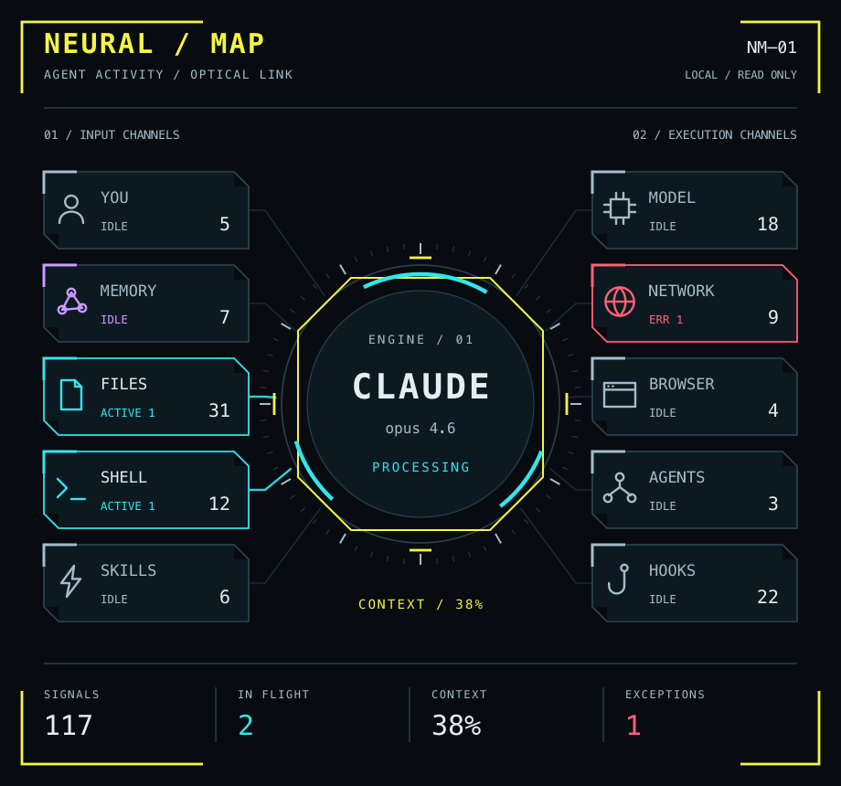
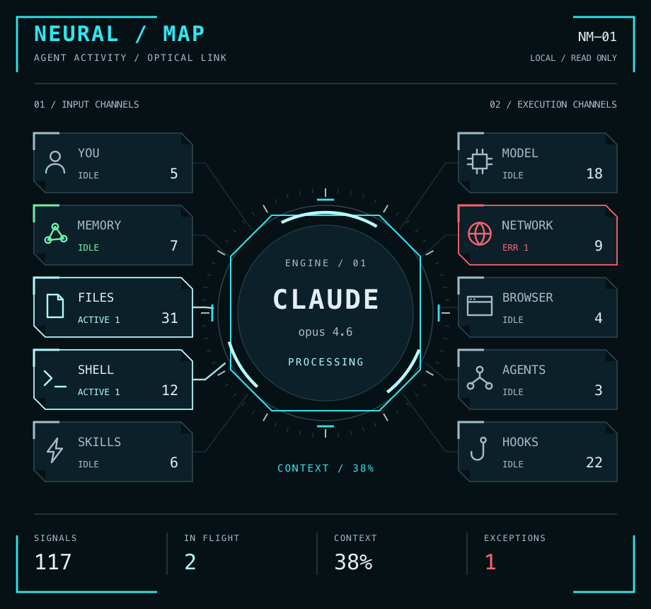
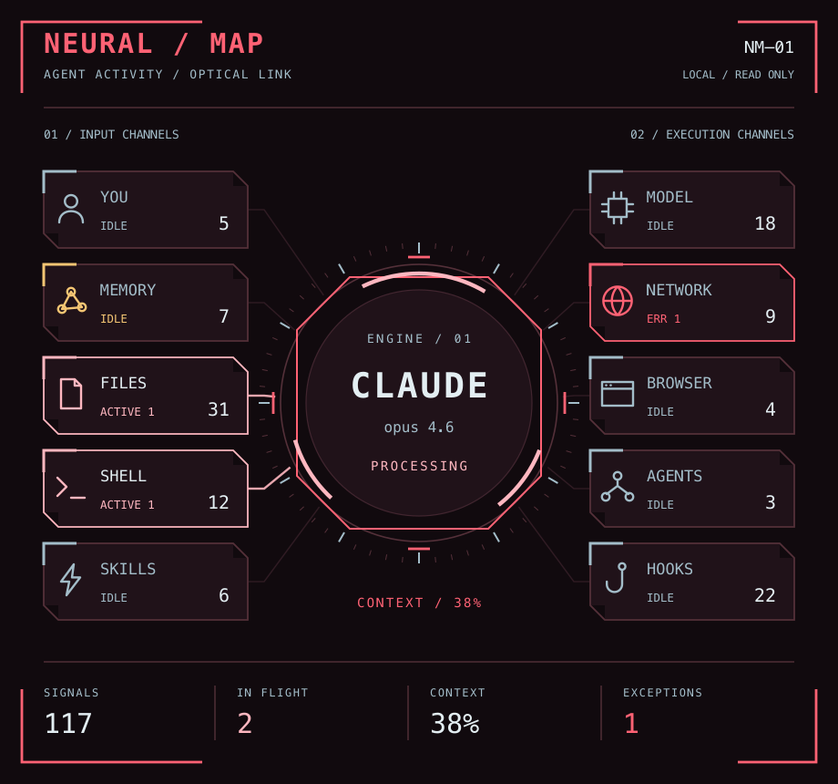

# Neural Map

### See your coding agent think in signals.

A **native Claude Code activity pane** with a cyberpunk HUD, live tool signals,
context tracking and switchable color themes. No browser tab, local web server,
extra model calls or dashboard to keep running.

An optical diagnostics interface inspired by Kiroshi OS: aligned channel strips,
one central iris, readable telemetry and restrained circuit framing.



*Preview generated by the plugin's own SVG renderer with sample activity. The live
pane uses native Claude UI controls and this same renderer.*

## Install in Claude Code

Requires Claude Code with native mod support. Validated with **2.1.327 on macOS**.
Use the **Claude Code** section of Claude Desktop; this is not a general Claude
chat connector.

At the Claude Code prompt:

```text
/plugin marketplace add AKS97i/neural-map
/plugin install neural-map@neural-map
```

Then run this in your terminal to enable the cyberpunk preset:

```bash
echo '{"colorPreset":"night-city","skin":"cyberpunk","motion":"reduced","theme":"dark"}' | claude plugin configure neural-map@neural-map --values-stdin
```

Start a **new session**. The pane opens automatically. Type `/neural-map` to reopen
it. If you already use lot-map, disable it for the session to avoid two maps.

For a terminal-only install:

```bash
claude plugin install neural-map --marketplace AKS97i/neural-map --config colorPreset=night-city --config skin=cyberpunk --config motion=reduced --config theme=dark
```

The compatibility defaults retain the original circular layout. The configuration
command above activates the angular HUD. The native **Theme** button cycles colors
immediately and remembers your choice for the next session.

## What lights up

Ten stations surround the engine: **You, Model, Memory, Files, Shell, Network,
Browser, Agents, Skills and Hooks**. Signals travel when calls begin and finish;
errors stay visible, active work has a clock, and heavily used connections grow.
The context ring shows the usage reported by Claude, including compaction.

- **Native pane:** the map lives beside your Claude Code conversation.
- **Five themes:** Night City, Netrunner, Arasaka, Monochrome and Classic.
- **Custom colors:** override individual palette colors through plugin settings.
- **Calmer mode:** reduced motion removes flying signals and spinning effects.
- **Bounded history:** 80 recent records, with ongoing background work retained.
- **No model overhead:** the mod does not make model calls or add prompt content.
- **No runtime dependencies:** no npm install, daemon or local HTTP service.

| Night City | Netrunner | Arasaka |
| --- | --- | --- |
|  |  |  |

## Themes and motion

Click **Theme: …** in the desktop pane to cycle palettes. The next session restores
that choice. This button is specific to the desktop pane; terminal and editor
configuration use plugin options.

```bash
# Settings apply when a new session starts.
echo '{"colorPreset":"netrunner","skin":"cyberpunk","motion":"full"}' | claude plugin configure neural-map@neural-map --values-stdin

# Your colors override preset colors.
echo '{"colors":"accent=#f4f444,active=#32e5ed,background=#080c10"}' | claude plugin configure neural-map@neural-map --values-stdin
```

Options include `colorPreset`, `skin` (`cyberpunk` / `classic`), `theme`
(`dark` / `light` / `auto`), `motion` (`full` / `reduced`), `textSize`, `layout`,
`coreName`, memory classification options, `contextCost` and `terminalView`.
Run `claude plugin configure neural-map@neural-map` to inspect them.

The terminal defaults to text. Braille is available. Raster terminal animation is
opt-in and substantially more expensive than the native SVG pane; keep it off if
you want a quiet monitor on a small laptop. The HUD has no perpetual breathing
animation when idle. Actual CPU and memory depend on Claude's renderer; we do not
claim a measured idle RAM or battery figure.

## Codex status

**A native embedded Codex pane is not implemented.** This repository currently
ships the Claude Code plugin. It does not use a browser panel or a floating window
as a substitute. See [the integration investigation](docs/codex-integration.md).

## Privacy

The native mod watches events Claude already provides. It does not read session
files, make network requests, run shell commands, call a model or change tool
results or approval decisions. Labels hold names and short descriptions rather
than command contents, search queries or file contents. See [PRIVACY.md](PRIVACY.md)
for the exact boundaries and the optional labels that may contain user text.

## Develop

```bash
git clone https://github.com/AKS97i/neural-map.git
cd neural-map
claude plugin validate .
claude plugin test .
node scripts/check-surface.mjs
claude --plugin-dir .
```

No account is needed for the validation and test commands. Tests cover event
pass-through, sensitive-label handling, theme switching, rendering and bounded
work. Desktop behavior is exercised with Claude's native UI test kit; it is not
yet independently verified in a user-authenticated live desktop session.

See [CONTRIBUTING.md](CONTRIBUTING.md) to report bugs or contribute themes. If this
makes your agent's work easier to follow, **star the repository** and share a
screenshot of your setup. Please remove private names and paths before sharing.

## Credits and license

Neural Map is a visual fork of [lot-map](https://github.com/alexeyw/lot-map) by
**Aleksei Volodin**. Its event engine, classification, native pane integration and
existing regression tests come from lot-map 0.9.0. This project adds the angular
HUD, color presets and a persistent native theme switcher. Please support the
original project too.

MIT licensed. The original copyright and license are retained in [LICENSE](LICENSE).
Cyberpunk 2077 is an aesthetic reference; this project uses no game assets and is
not affiliated with CD PROJEKT RED, Anthropic or OpenAI.
